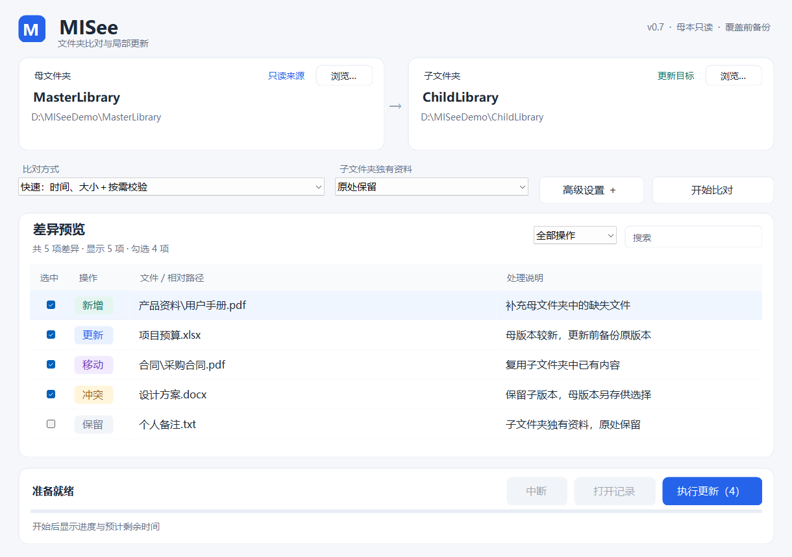

# MISee · 咪看看

Windows 文件夹比对与局部更新工具。以母文件夹为标准，复用子文件夹已有内容，补齐缺失资料，并保留更新前版本。

当前版本：**0.7.0** · C# / .NET 10 / Windows Forms



## 功能

- **快速比对**：按路径、大小、修改时间与有效指纹生成差异，避免日常更新反复读取整库内容。
- **内容校验可选**：快速、缓存内容、完整内容三种方式；执行前完整复核可单独选择。
- **增量索引**：复用本机指纹，结合在线变更通知刷新局部；通知不可靠时安全退回元数据扫描。
- **内容复用**：先按大小筛选，再校验内容，优先移动复用子本已有文件。
- **更新保护**：母本只读，覆盖前备份，保留较新子版本，同日期冲突保留双方。
- **清晰的任务界面**：差异搜索与筛选、进度、预计剩余时间、安全中断和执行记录。

## 使用

1. 在 Windows 上安装 [.NET 10 Windows Desktop Runtime x64](https://dotnet.microsoft.com/download/dotnet/10.0)。从源码编译则安装对应 SDK。
2. 运行程序，选择母文件夹和子文件夹。
3. 点击“开始比对”，核对并勾选差异。
4. 点击“执行更新”。运行期间可点击“中断”，结束后可打开记录。

默认：快速比对、独有资料原处保留、跳过执行前整库复核、核验实际写入内容。高级设置中保留全部性能与校验选项。

快速方式将没有有效双方指纹的同路径、同大小、同时间文件按一致处理。检查静默损坏或人为保留时间戳的内容变化时，使用“完整内容”方式。目录修改时间不能代表全部后代内容的版本；exFAT 也不能依赖 NTFS USN 日志。

详细说明：[使用指南](docs/USER_GUIDE.md) · [索引与性能设计](docs/ARCHITECTURE.md) · [测试](docs/TESTING.md) · [更新记录](CHANGELOG.md)

## 构建、测试与打包

需要 Windows、.NET 10 SDK、PowerShell。

```powershell
./scripts/build.ps1
./scripts/test.ps1
./scripts/package.ps1
```

生成目录：`artifacts/build/`、`artifacts/test-results/`、`artifacts/packages/`。仓库不包含 SDK、运行时、私人执行记录或已编译程序；可复现构建脚本及 Windows CI 已提供。CI 构建产物可在对应 Actions 运行中下载。

项目入口：`Source/GreenFolder.csproj`。源码目录名保留历史命名，程序名称为 MISee。

## 测试范围

自建资料测试覆盖基础规则、内容匹配、覆盖备份、中断清理、索引、筛选与布局等，当前包含 **199 项断言**。目录缓存测试会等待初始监控通知收敛，再检查稳定状态下的零扫描行为。

窗口缩小和常规布局已检查；实际 125%／150% 系统缩放仍需单独验证。示例截图和测试路径均为演示资料，不包含实际用户文件。

## 许可证

当前尚未指定开源许可证。
