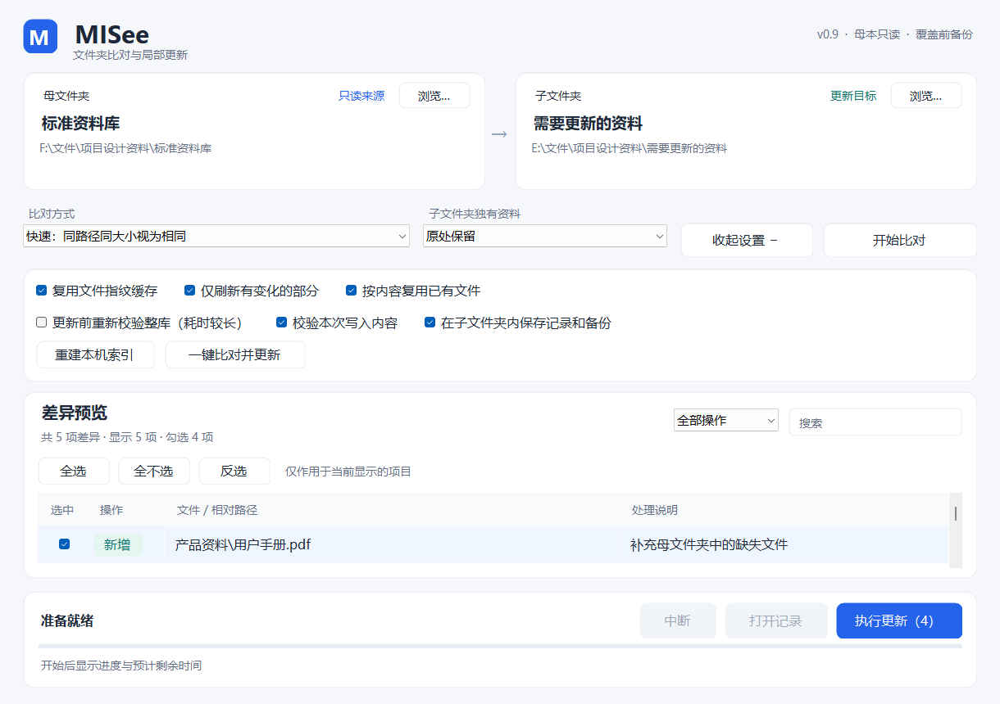

# MISee · 咪看看

Windows 文件夹比对与局部更新工具。当前版本 **0.9.0**，C# / .NET 10 / Windows Forms。

[下载完整 Windows 程序包](downloads/MISee-v0.9.0-win-x64.zip) · [自动构建与测试](https://github.com/ZHC00813/MISee/actions/workflows/windows.yml)

## 功能和使用

1. 选择母文件夹与子文件夹，点击“开始比对”。母本始终只读。
2. 同一相对路径（含文件名）的文件，只要字节大小完全相同，就视为相同，忽略修改时间和指纹差异。此规则适用于全部三种扫描模式。大小一致不保证内容逐字节一致。
3. 使用操作筛选和路径搜索，再用“全选、全不选、反选”批量勾选当前显示项目；隐藏项目保留勾选状态。清除筛选即可操作完整清单。
4. 在“高级设置”选择是否“在子文件夹内保存记录和备份”。默认勾选。取消后，新日志、计划、覆盖前备份和冲突副本改存本机应用数据目录下的 MISee/Records，不创建新的子目录记录，已有记录不删除。
5. 核对预览后执行更新。完成后点击“打开记录”可打开本次实际保存位置。

大小不同的文件沿用日期规则：母本较新时备份后更新，子本较新时保留，同日期冲突另存母版本。路径不同的同大小文件仍需校验内容后才能移动复用。更新前复核和本次写入校验可以分别选择；写入期间仍检查源文件和目标是否发生变化。

独有资料的“移到额外资料”设置独立于记录位置，仍会在子文件夹的“额外资料（MISee）”内归档；不希望产生归档目录时选择“原处保留”。

## 运行与构建

程序包包括可运行程序、完整源码和说明，需要 Windows x64 及 .NET 10 Windows Desktop Runtime。直接运行“程序/咪看看（MISee）.exe”。

源码构建需要 Windows、.NET 10 SDK、PowerShell：

~~~powershell
./scripts/build.ps1
./scripts/test.ps1
./scripts/package.ps1
~~~

本次本地九组测试共 **232 项断言**通过：规则、记录位置、覆盖备份、复用、取消、索引、界面选择与布局。未同步用户真实资料，未单独切换实际 125%/150% 系统缩放。CI 状态以 Actions 页面为准。

[使用指南](docs/USER_GUIDE.md) · [设计](docs/ARCHITECTURE.md) · [测试](docs/TESTING.md) · [更新记录](CHANGELOG.md)

尚未指定开源许可证。
